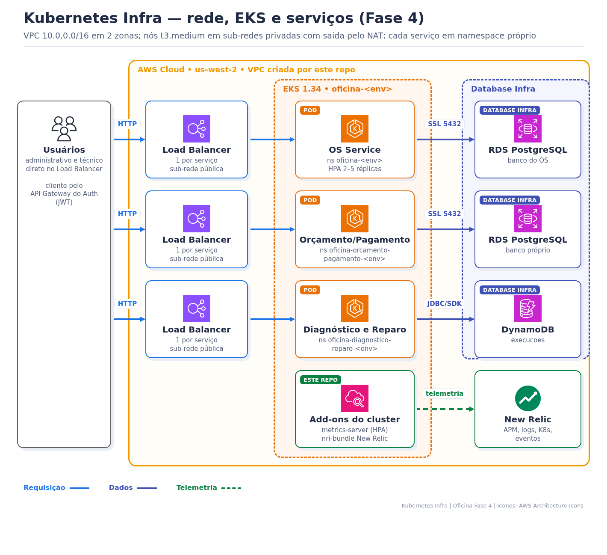
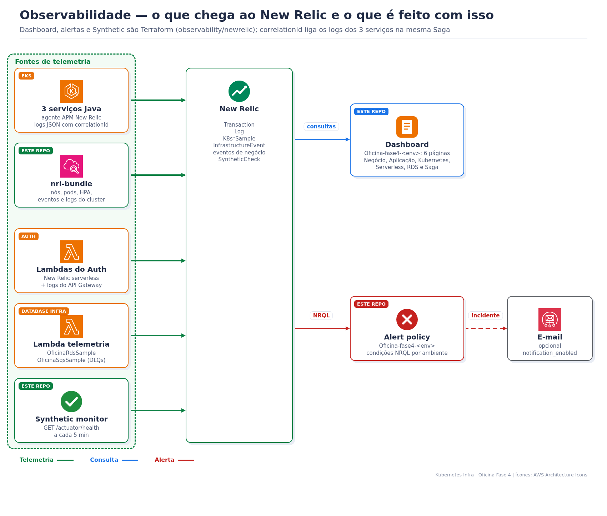

> **Tech Challenge Fase 4 — `oficina-kubernetes-infra`**
>
> Rede, Amazon EKS, add-ons do cluster e observabilidade New Relic como código.

# Oficina Fase 4 — Kubernetes Infra

## 1. Objetivo de negócio

É a plataforma em que os três serviços da oficina rodam. Ela mantém o atendimento disponível quando um pod falha, aumenta a capacidade quando a demanda sobe e mostra, num só lugar (New Relic), se as Ordens de Serviço estão andando, onde a Saga parou e qual componente está com erro.

Este repositório não tem regra de negócio: os manifests de cada serviço (Deployment, Service, HPA, PDB) ficam no próprio serviço.

## 2. Arquitetura



| Camada | O que este repo cria | Arquivo |
|---|---|---|
| Rede | VPC `10.0.0.0/16`, 2 zonas (`us-west-2a/b`), sub-redes públicas e privadas, Internet Gateway e NAT | `network.tf` |
| Cluster | EKS `1.34` `oficina-<env>`, logs do control plane (7 dias) e add-ons `vpc-cni`, `coredns`, `kube-proxy` | `eks.tf` |
| Nós | node group `ON_DEMAND` `t3.medium`, 1–3 nós (2 desejados), launch template com IMDS hop limit 2 para os pods usarem a `LabRole` | `eks.tf` |
| Add-ons Helm | `metrics-server` 3.13.1 (HPA) e `nri-bundle` 8.0.10 (New Relic) | `kubernetes/addons/`, `scripts/deploy-cluster-addons.sh` |
| Observabilidade | dashboard, alertas, Synthetic e notificação | `observability/newrelic/` |

**Namespaces e workloads** (manifests em cada serviço):

| Namespace | Deployment | Réplicas / HPA (CPU 70%) | Exposição |
|---|---|---|---|
| `oficina-<env>` | `oficina-app` (OS Service) | 2 → 2–5, PDB `minAvailable: 1` | Service `LoadBalancer` |
| `oficina-orcamento-pagamento-<env>` | `oficina-orcamento-pagamento` | 1 → 1–3 | Service `LoadBalancer` |
| `oficina-diagnostico-reparo-<env>` | `oficina-diagnostico-reparo` | 1 → 1–3 | Service `LoadBalancer` |
| `newrelic`, `kube-system` | `nri-bundle`, `metrics-server` | DaemonSet / 1 | — |

Os clientes chegam pelo API Gateway do [Auth Serverless](https://github.com/tiagomiele/oficina-auth-serverless), que repassa ao Load Balancer do serviço. O HPA escala só por CPU, porque a memória da JVM não cai depois do pico.

## 3. Requisitos funcionais

| Requisito | Onde está |
|---|---|
| Cluster isolado por ambiente (`homolog` e `production`) | `eks.tf`, `environments/*.tfvars.example`, workspaces HCP |
| Autoescala de pods por CPU | `metrics-server` + `k8s/hpa.yaml` dos serviços |
| Telemetria de nós, pods, HPA, eventos e logs | `kubernetes/addons/nri-bundle.values*.yaml` |
| Dashboard de negócio, aplicação, Kubernetes, serverless, RDS e Saga | `observability/newrelic/dashboard.tf` |
| Alertas de Saga, DLQ, erro, latência, pods, Lambdas, API Gateway e RDS | `observability/newrelic/alerts.tf`, `rds-alerts.tf` |
| Healthcheck externo do OS Service | `observability/newrelic/synthetics.tf` |
| Rede entregue ao Database e ao Auth sem copiar IDs à mão | `scripts/sync-network-outputs.py` |

## 4. Requisitos técnicos

- Nós em sub-redes privadas; só os Load Balancers ficam nas públicas.
- Sem IAM declarado: cluster e nós usam a `LabRole` do AWS Academy.
- Versões de charts fixadas em `kubernetes/addons/versions.env` e validadas com `helm template`.
- `lowDataMode: true` no New Relic para caber na cota gratuita.
- `scripts/check-aws-session.sh` falha cedo quando a sessão do Lab expirou.

## 5. Stack técnica

| Área | Tecnologias |
|---|---|
| Nuvem | AWS VPC, NAT Gateway, Amazon EKS 1.34, managed node group, ELB |
| Orquestração | Kubernetes, Helm, metrics-server, HPA, PDB, probes |
| IaC | Terraform ≥ 1.6, HCP Terraform (workspace de infraestrutura e de observabilidade por ambiente), providers AWS e New Relic |
| Observabilidade | New Relic `nri-bundle` (infra, kube-state-metrics, kube-events, logging), APM Java, serverless, Synthetics, NRQL |
| Automação | GitHub Actions, Bash, Python e PowerShell |
| Qualidade e segurança | `terraform validate`, TFLint, yamllint, ShellCheck, actionlint, `unittest`, Trivy e Gitleaks |

## 6. Observabilidade



### 6.1 O que chega ao New Relic

| Fonte | Dados | Onde consultar |
|---|---|---|
| Agente Java dos 3 serviços (`oficina-os-service-<env>`, `oficina-orcamento-pagamento-service-<env>`, `oficina-diagnostico-reparo-service-<env>`) | `Transaction`, `TransactionError`, traces | APM & Services |
| Logs JSON dos pods (via `newrelic-logging`) | `Log` com `correlationId`, `level`, `namespace_name` | Logs |
| `nri-bundle` | `K8sContainerSample`, `K8sPodSample`, `K8sDeploymentSample`, `K8sHpaSample`, `InfrastructureEvent` | Kubernetes |
| OS Service | eventos de negócio `OrdemServicoCriada`, `OrdemServicoStatusAlterado`, `OrdemServicoProcessamentoFalhou`, `IntegracaoExternaFalhou` | Query your data |
| Lambdas do Auth e API Gateway | `Transaction` serverless e logs de acesso | Serverless / Logs |
| Lambda do [Database Infra](https://github.com/tiagomiele/oficina-database-infra) | `OficinaRdsSample`, `OficinaSqsSample` | Query your data |
| Synthetic `oficina-<env>-healthcheck` | `SyntheticCheck` de `/actuator/health` a cada 5 min | Synthetic monitoring |

### 6.2 Dashboard `Oficina-fase4-<env>`

| Página | Mostra |
|---|---|
| Negócio | OS criadas, volume diário, tempo por etapa, transições, falhas |
| Aplicação | throughput, latência média/P95, 4xx/5xx, taxa de erro, uptime, transações lentas, logs de erro |
| Kubernetes | CPU e memória por pod, réplicas, HPA, reinícios, pods, eventos |
| Serverless e API Gateway | invocações, duração, cold starts, erros, latência e respostas |
| RDS PostgreSQL | CPU, conexões, armazenamento, latência, IOPS, erros e consultas lentas |
| Saga | eventos aplicados, compensações, mensagens nas DLQs, falhas por serviço e rastreio por `correlationId` |

### 6.3 Alertas (policy `Oficina-fase4-<env>`)

| Grupo | Condições | Produção |
|---|---|---|
| Saga | DLQ com mensagens (> 0), falhas de processamento (> 5) | — |
| Aplicação | taxa de erro, latência P95, healthcheck indisponível, falha de OS, falha de integração | erro > 5%, P95 > 1200 ms |
| Kubernetes | pod indisponível, reinícios, CPU, memória, HPA no máximo | CPU e memória > 80% |
| Serverless | erros de Lambda, 5xx e latência do API Gateway | Lambda > 2, 5xx > 2 |
| RDS | CPU, conexões, armazenamento baixo, erros PostgreSQL, telemetria ausente | — |
| Plataforma | telemetria do cluster ausente | — |

Os limiares de homologação são mais folgados (erro 10%, P95 2000 ms, CPU/memória 85%). E-mail só com `notification_enabled = true`.

### 6.4 Rastrear uma OS pela Saga

Todos os serviços registram o mesmo `correlationId` da OS. No New Relic → **Logs** ou **Query your data**:

```sql
SELECT timestamp, namespace_name, level, message FROM Log
WHERE correlationId = '<correlationId>' SINCE 1 day ago ORDER BY timestamp
```

Para achar o `correlationId`: `SELECT correlationId, message FROM Log WHERE message LIKE '%OS-102026-000003%' SINCE 1 day ago LIMIT 10`.

## 7. Operação

```powershell
aws eks update-kubeconfig --region us-west-2 --name oficina-production   # ou oficina-homolog
kubectl get nodes
kubectl get pods -A | Select-String -NotMatch 'Running|Completed'
kubectl get hpa -A
kubectl get svc -A | Select-String LoadBalancer
kubectl logs -n oficina-production deploy/oficina-app --tail 100
kubectl get pods -n newrelic
```

Se `kubectl get nodes` responder `No resources found` depois de reiniciar o Lab, troque as instâncias do node group: `aws autoscaling terminate-instance-in-auto-scaling-group --instance-id <id> --no-should-decrement-desired-capacity`.

## 8. Como executar

### 8.1 Validar localmente (sem AWS)

```bash
terraform fmt -check -recursive
terraform init -backend=false -input=false && terraform validate
terraform -chdir=observability/newrelic init -backend=false -input=false && terraform -chdir=observability/newrelic validate
tflint --recursive
python3 -m unittest discover -s tests -p 'test_*.py'
./scripts/lint-cluster-addons.sh
```

### 8.2 Aplicar e destruir

Este é o **primeiro** repositório a aplicar, porque gera a rede usada pelo Database e pelo Auth. O passo a passo dos 6 repositórios, inclusive a destruição em ordem para economizar créditos, está no Bootstrap da Fase 4 do [OS Service](https://github.com/tiagomiele/oficina-os-service). O `configure-environment.ps1` cria os workspaces e grava as variáveis (inclusive `apm_application_name`, `lambda_function_names` e `health_check_url`).

## 9. CI/CD

| Workflow | Quando | O que faz |
|---|---|---|
| `ci.yml` | push e PR em `homolog`/`main` | valida Terraform, scripts, Helm, workflows e segurança |
| `terraform-plan.yml` | PR | plan, sem apply |
| `deploy-homolog.yml` | push na `homolog` ou manual | sessão AWS → apply da infra → sincroniza rede com Database e Auth → add-ons Helm → verifica rollout → apply da observabilidade |
| `deploy-production.yml` | push na `main` ou manual | o mesmo, no ambiente `production` protegido |

Promoção: `feature → PR → homolog → PR → main`. Diagramas: [CI/CD](docs/cicd.md).

## 10. Variáveis e outputs

| Variável | Padrão |
|---|---|
| `aws_region`, `environment`, `project_name` | `us-west-2`, `homolog`, `oficina` |
| `vpc_cidr`, `public_subnet_cidrs`, `private_subnet_cidrs` | `10.0.0.0/16`, `10.0.0-1.0/24`, `10.0.10-11.0/24` |
| `cluster_version`, `node_instance_types` | `1.34`, `t3.medium` |
| `node_min_size`, `node_desired_size`, `node_max_size` | 1, 2, 3 |
| New Relic (`observability/newrelic`) | `newrelic_account_id`, `newrelic_api_key` (sensível), `synthetic_monitor_enabled`, `notification_email`, `alert_thresholds` |

Exemplos: [homolog](environments/homolog.tfvars.example), [production](environments/production.tfvars.example), [New Relic production](observability/newrelic/environments/production.tfvars.example). Não versione `.tfvars` com chaves.

Outputs: `vpc_id`, `public_subnet_ids`, `private_subnet_ids`, `eks_cluster_name`, `eks_cluster_endpoint`, `eks_cluster_security_group_id` e `kubectl_config_command`.

## 11. Repositórios relacionados

| Repositório | Papel |
|---|---|
| [oficina-os-service](https://github.com/tiagomiele/oficina-os-service) | Ordem de Serviço, Saga, documentação central e Bootstrap |
| [oficina-orcamento-pagamento-service](https://github.com/tiagomiele/oficina-orcamento-pagamento-service) | orçamento e pagamento |
| [oficina-diagnostico-reparo-service](https://github.com/tiagomiele/oficina-diagnostico-reparo-service) | diagnóstico e reparo |
| [oficina-auth-serverless](https://github.com/tiagomiele/oficina-auth-serverless) | login por CPF e API Gateway |
| [oficina-database-infra](https://github.com/tiagomiele/oficina-database-infra) | bancos e filas |

## Licença

Consulte o arquivo [LICENSE](LICENSE).
